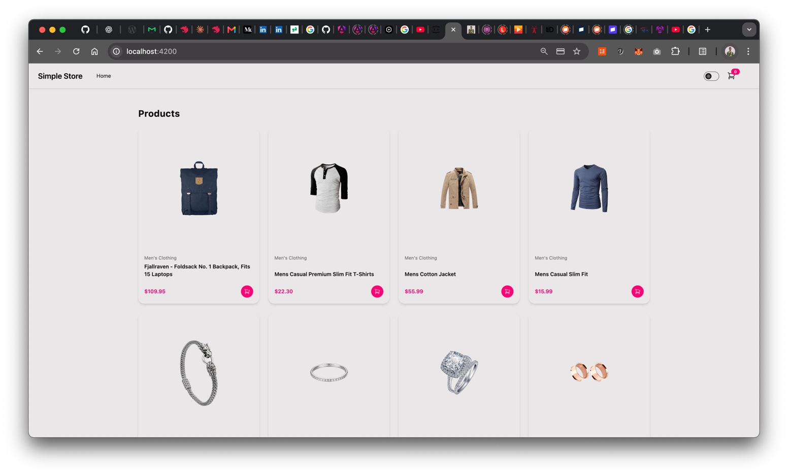
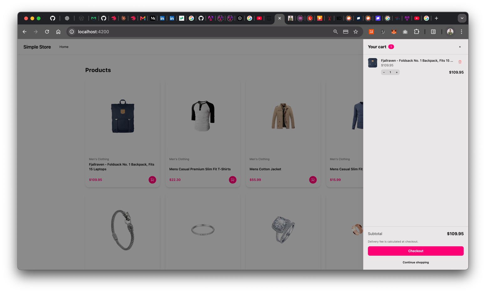
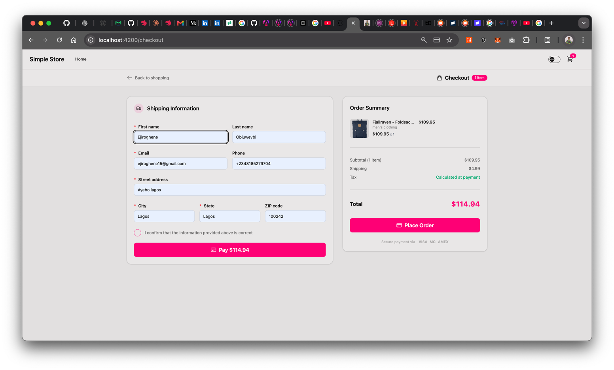
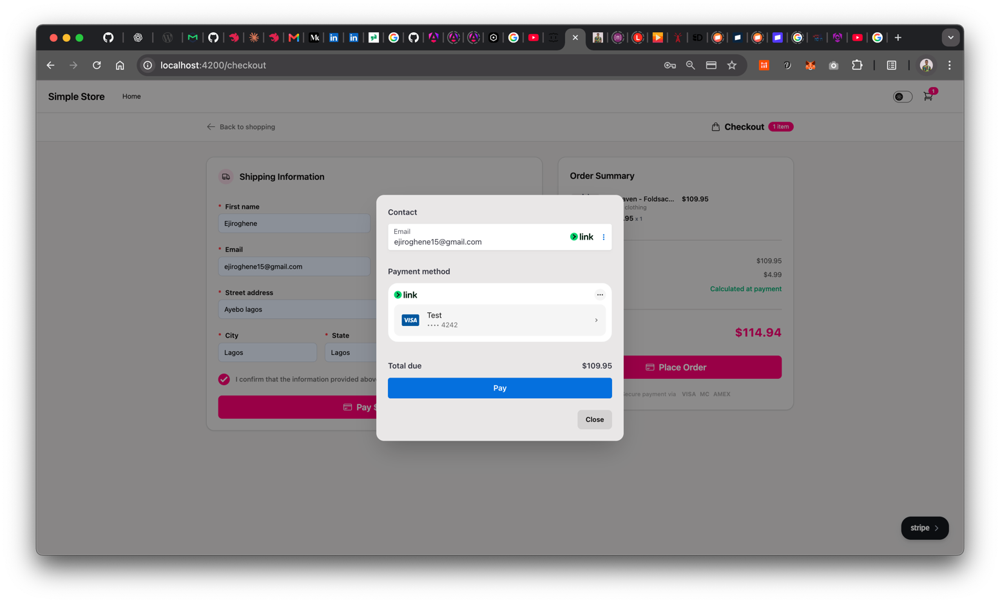
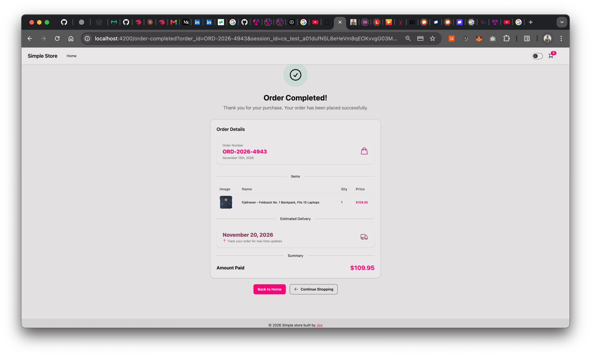

# Simple Store

A modern e-commerce demo application built with **Angular 22** that showcases the latest Angular features including signals, resource APIs, `@defer` blocks, and signal-based forms.

The app allows users to browse products, add items to a cart, and complete purchases through a Stripe-powered checkout flow. It's styled with **Tailwind CSS** and **daisyUI** for a clean, themeable UI that supports both light and dark modes.

## Features

- **Product Browsing** — Fetches products from the FakeStore API and displays them in a responsive grid with skeleton loading states using Angular's `@defer` for code splitting.
- **Shopping CartStore** — Add products to the cart with real-time quantity management and toast notifications.
- **Checkout with Stripe** — Complete orders with shipping details validation using Angular Signals Forms and payment processing via Stripe Checkout.
- **Settings** — User profile and security settings pages with nested routing.
- **Theme Switching** — Toggle between light and dark themes using daisyUI theme controller.
- **Responsive Design** — Mobile-first layout built with Tailwind CSS and daisyUI components.

## Tech Stack

- **Angular 22** — Standalone components, signals, `resource()`, `@defer`, and signal-based forms
- **Tailwind CSS 4** — Utility-first CSS framework
- **daisyUI 5** — Component-based UI library built on Tailwind CSS
- **Stripe** — Payment processing integration
- **NgIcons** — Icon library with Heroicons support
- **Vitest** — Unit testing framework

## Screenshots

### Home Page

The home page displays a product grid with skeleton placeholders while data loads, and a clean card layout with hover-to-add interactions.



### Shopping CartStore

The cart page shows selected items with quantity controls and order summary.



### Checkout

The checkout page collects shipping details with form validation using Angular Signals Forms.



### Stripe Payment

The Stripe checkout page handles secure payment processing.



### Order Complete

The order confirmation page displays the successful purchase summary.



## Development server

To start a local development server, run:

```bash
ng serve
```

Once the server is running, open your browser and navigate to `http://localhost:4200/`. The application will automatically reload whenever you modify any of the source files.

## Code scaffolding

Angular CLI includes powerful code scaffolding tools. To generate a new component, run:
